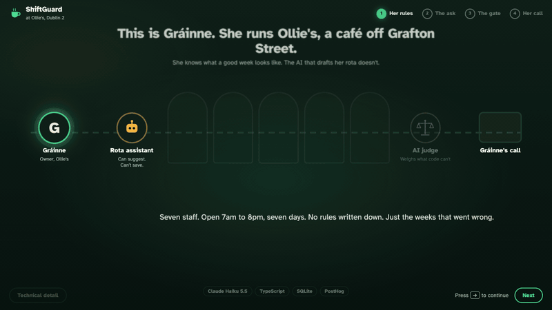
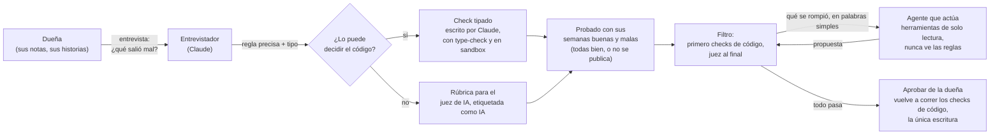
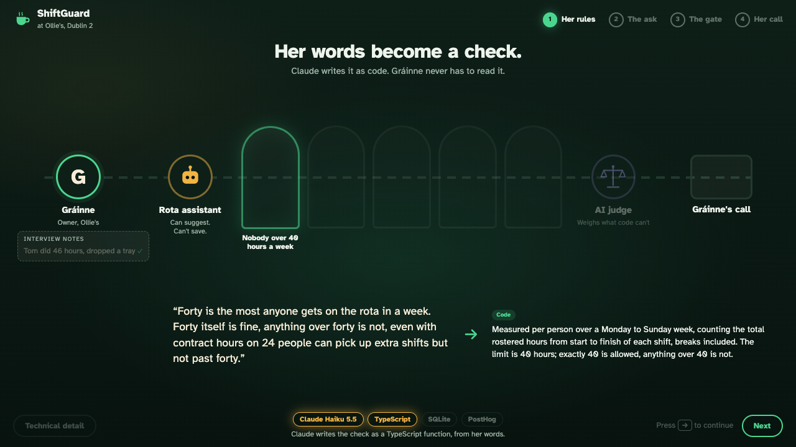
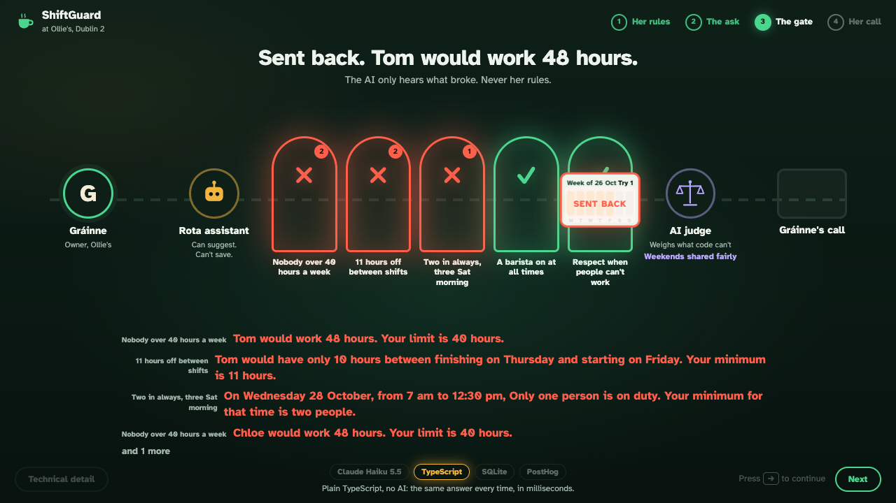
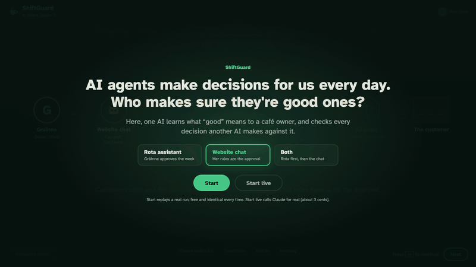

# taste-to-evals

[English](README.md)

[](https://github.com/AIwithDiego/taste-to-evals/actions/workflows/ci.yml)   

**Los agentes proponen, las reglas del dueño deciden, cada decisión deja evidencia.**

10.000 cambios aleatorios a la planilla de turnos: todo borrador que rompía una regla fue detenido y ninguno bueno fue bloqueado. Reproduce la prueba con `pnpm stress`; no necesitas API key.

<sub>Hecho por [AIwithDiego](https://www.aiwithdiego.com). ¿Lo necesitas para tu equipo? [Hablemos](https://www.aiwithdiego.com).</sub>



*Presentado en AI Tinkerers Dublin, 28 de octubre de 2026. Corre en local; todos los nombres y números son sintéticos.*

```bash
git clone https://github.com/AIwithDiego/taste-to-evals && cd taste-to-evals && pnpm install && pnpm demo
```

## Por qué existe

Los agentes ya están empezando a armar turnos del personal, responder a clientes y reservar mesas para negocios. Muchos funcionan sin supervisión y no dejan registro de por qué hicieron lo que hicieron. Las reglas que deberían seguir viven en la cabeza de la dueña, y el agente que actúa por ella muchas veces es de un proveedor, con un prompt que ella no controla.

Este proyecto pone un filtro entre el agente y el negocio. Una entrevista convierte las reglas de la dueña en tests. El agente solo puede proponer. Cada propuesta tiene que pasar los tests antes de que una persona la apruebe, y cada decisión tiene un trace y una página de evidencia para auditarla después.

## Los controles

| Control | Qué hace | Dónde |
|---|---|---|
| **Mínimo privilegio** | El agente que actúa tiene dos herramientas de solo lectura, nunca ve las reglas y solo se entera de qué se rompió. Un test falla si alguna vez recibe una vía de escritura. | `src/agent.ts`, `src/agent.test.ts` |
| **Supervisión humana** | Aprobar es el único código que guarda una planilla de turnos, y vuelve a correr cada check de código en vez de confiar en el resultado guardado. | `src/store.ts` |
| **Código generado aislado** | Los checks que escribe Claude se revisan (sin imports, `eval`, timers ni nombres de red) y corren en un contexto `node:vm` vacío con un límite de un segundo. | `src/sandbox.ts` |
| **Primero código, juez de IA al final** | El código decide cada regla que puede. El juez de IA evalúa solo lo que queda, corre solo después de que pasa el código y está etiquetado como "IA" en todas partes. | `src/gate.ts`, `src/judge.ts` |
| **Evidencia por decisión** | Un PDF de una página por ejecución: qué se pidió, cada intento, el veredicto de cada regla, la razón del juez, quién aprobó y cuánto costó. [Ejemplo](docs/evidence-sample.pdf). | `src/evidence.ts` |
| **Observabilidad, privada por defecto** | Cada ejecución en vivo puede ser un trace en PostHog: cada llamada a Claude con tokens, costo y latencia, y cada check como un span. A analytics solo va la estructura; prompts, respuestas y nombres quedan fuera a menos que los actives. | `src/telemetry.ts`, `src/telemetry.test.ts` |
| **Medido, en CI** | 10.000 cambios aleatorios a la planilla pasan por los checks que escribió Claude y por una versión escrita a mano de las mismas reglas. CI falla ante cualquier diferencia. [Resultados](docs/stress-test.md). | `src/stress.ts`, `src/reference.ts` |

## EU AI Act y GDPR

ShiftGuard es una demo local con datos sintéticos (Ollie's y su personal son inventados). No es un producto y no declara cumplimiento. Fue diseñado teniendo en cuenta el EU AI Act y el GDPR. Un asistente de turnos podría ser un sistema de alto riesgo según el Anexo III, punto 4(b) del AI Act (asignación de tareas en el trabajo), dependiendo de en qué base sus decisiones. Si es así, esas obligaciones aplican desde el 2 de diciembre de 2027 según el AI Omnibus de 2026. La tabla relaciona cada control con el artículo contra el que se construyó.

| Requisito | Qué pide | Dónde lo hace este repo |
|---|---|---|
| AI Act Art. 12 | Registros automáticos de lo que hizo el sistema | Registro de ejecución por propuesta (`src/propose.ts`) y PDF de evidencia con cada intento, veredicto, razón del juez, aprobador y costo (`src/evidence.ts`) |
| AI Act Art. 14 | Una persona puede supervisar, anular y decidir | Solo el Aprobar de la dueña escribe una planilla de turnos, y antes vuelve a correr los checks de código (`src/store.ts`) |
| AI Act Art. 15 | Precisión, robustez, ciberseguridad | 10.000 cambios aleatorios a la planilla contra reglas de referencia escritas a mano: 9.549 de 9.549 semanas malas detenidas, 0 de 451 semanas buenas bloqueadas (`src/stress.ts`, `docs/stress-test.md`). Los checks generados corren en `node:vm` sin imports, eval ni red, y con un límite de un segundo (`src/sandbox.ts`) |
| AI Act Art. 50 | Las personas saben cuándo interviene una IA | El chat del sitio web les dice a los clientes que están hablando con un asistente de IA (`web/main.ts`). Los veredictos del juez de IA están etiquetados como "IA" en el filtro y en el PDF (`src/gate.ts`, `src/evidence.ts`) |
| Mínimo privilegio | El agente no puede actuar más allá de su función | El asistente de turnos solo tiene `read_week` y `read_staff`. Un test falla si aparece una vía de escritura (`src/agent.ts`, `src/agent.test.ts`) |
| GDPR Art. 5(1)(c), Art. 25 | Minimización de datos, privacidad por defecto | Telemetría desactivada por defecto. Si se activa, envía pasos, veredictos, tokens y costo al host de PostHog en la UE mediante una allow-list de campos. Prompts, respuestas, texto de las reglas y el nombre del aprobador solo con `SHIFTGUARD_TELEMETRY_CONTENT=on` (`src/telemetry.ts`, `src/telemetry.test.ts`) |
| GDPR Art. 22 | Ninguna decisión únicamente automatizada con efecto significativo | Ninguna planilla de turnos entra en vigor sin la aprobación de una persona con nombre (`src/store.ts`) |

### Lo que todavía necesitaría un despliegue real

- Una clasificación documentada según el AI Act, incluido si aplica la excepción del Art. 6(3).
- Una DPIA (GDPR Art. 35) y una base legal para los datos del personal.
- Informar a los trabajadores antes del uso (AI Act Art. 26(7) para un empleador que actúa como responsable del despliegue; aviso del GDPR Art. 13).
- Los motivos de ausencia del personal, como "con licencia médica", son datos de salud (GDPR Art. 9). La demo los guarda como texto libre.
- Reglas de retención y borrado para los registros de ejecución y los PDF de evidencia.
- Un acuerdo de tratamiento de datos y una base para la transferencia con el proveedor del modelo: los prompts, incluidos los datos del personal, van a la API de Anthropic.
- Un sandbox de nivel productivo. `node:vm` no es una frontera de seguridad.
- La regla del juez de IA no está en el stress test, y Aprobar reutiliza su veredicto en vez de volver a preguntar.
- El chatbot del sitio web envía respuestas sin que una persona apruebe cada una (el filtro es la aprobación).
- Prueba de que las aprobaciones son reales y no un simple timbre.

## Cómo funciona

El caso: Gráinne lleva Ollie's, un café inventado en Dublín. Nunca escribió sus reglas. Un asistente de turnos, que nunca ha visto sus reglas y no puede guardar nada, tiene que pasar cada borrador por su filtro. Solo su Aprobar cambia la semana.



1. **La entrevista pregunta por semanas malas, no por reglas.** "Cuéntame de una vez en que los turnos salieron mal por las horas." Gráinne: Tom hizo 46 horas cubriendo a Niamh y se le cayó una bandeja llena en la hora punta del sábado. De ahí sale *Máximo 40 horas a la semana, descansos incluidos, 40 exactas está permitido, sin excepciones por cubrir licencias médicas.* (`src/interview.ts`)
2. **Cada regla se vuelve un check o una rúbrica.** Si el código puede decidirla a partir de los hechos, Claude escribe una función TypeScript `check(rota)`. Si requiere criterio ("fines de semana repartidos de forma justa"), se vuelve una rúbrica para un juez de IA, etiquetado como IA en todas partes donde aparece. (`src/generate.ts`, `src/judge.ts`, resultado en [`checks/`](checks/))
3. **Ninguna regla se publica sin ejemplos.** Cada check corre contra semanas que la dueña considera bien y semanas que no, más casos borde que escribe Claude. Tiene que acertar en todos antes de proteger algo. (`src/setup.ts`, `src/examples.ts`)
4. **El agente que actúa está acotado.** El asistente de turnos tiene dos herramientas, `read_week` y `read_staff`. Nunca ve las reglas de ella; cuando un borrador rompe una, solo se entera de qué se rompió ("Tom trabajaría 48 horas. Tu límite es 40."). Los tests fallan si alguna vez recibe una herramienta que no sea de solo lectura o que pueda llegar al store. (`src/agent.ts`, `src/agent.test.ts`)
5. **Primero código, juez al final.** El filtro corre cada check tipado. Al juez de IA solo se le pregunta cuando todos pasan, así el modelo nunca vota sobre algo que la aritmética puede resolver. (`src/gate.ts`)
6. **Solo la persona escribe.** Aprobar es la única ruta de código que guarda una planilla de turnos, y vuelve a correr cada check de código en vez de confiar en el resultado guardado (el veredicto del juez de IA se toma de la ejecución). (`src/store.ts`)
7. **Cada ejecución deja evidencia.** Un PDF de una página por ejecución: qué se pidió, cada intento, qué dijo cada regla, la razón del juez, quién aprobó y cuánto costó. [Ejemplo](docs/evidence-sample.pdf). (`src/evidence.ts`)

El recorrido completo, con el modelo de datos y los límites de seguridad, está en [docs/how-it-works.md](docs/how-it-works.md).

| Sus palabras se vuelven un check | El filtro devuelve el borrador |
|---|---|
|  |  |

## Segundo acto: el mismo filtro en un chatbot de sitio web

En la demo, la gente preguntó si esto solo funciona para turnos. No: el segundo acto apunta el mismo filtro al chat del sitio web de Ollie's, que habla con clientes sin que nadie lo revise antes.

- Las reglas del chatbot de Gráinne salen de la misma entrevista: nunca decir que algo es seguro para alérgicos a menos que su hoja de alérgenos lo diga, nunca descuentos, reservas de hasta 8 personas entre las 7am y las 7pm, y "que suene como nosotros" (juzgada).
- El código no puede leer texto libre de forma confiable, así que **Claude lee, el código decide**: Claude lista solo lo que un borrador de respuesta *promete* (una reserva para 10 a las 7:30pm), y los checks tipados de ella deciden sobre esas promesas.
- El chat les dice a los clientes desde el principio que están hablando con un asistente de IA (EU AI Act Art. 50(1)).
- Los clientes no pueden esperar a una persona, así que aquí **el filtro es la aprobación**. Una respuesta que pasa sale en más o menos un segundo. Un borrador detenido vuelve al bot solo con lo que se rompió. Después de tres borradores detenidos, el cliente recibe un mensaje de espera y la pregunta queda pendiente para Gráinne.



### Dónde más sirve el filtro

El patrón necesita tres cosas: un agente que **propone** en vez de actuar, reglas sobre las que el dueño puede contar historias, y una única ruta, humana o de código, que **escribe**. Lugares donde aplica directamente:

| Agente | Reglas del dueño que se vuelven checks | Juzgado |
|---|---|---|
| Reembolsos y devoluciones | Nunca más de €50 sin una persona; nunca en artículos de venta final | "¿Se trató al cliente de forma justa?" |
| Compras | Solo proveedores aprobados; nada por encima del presupuesto por categoría | "¿Es un pedido sensato para la semana?" |
| Reserva de citas | Nunca reservar dos veces una sala; 15 minutos entre clientes | Tono de la confirmación |
| Email saliente | Nunca mencionar precios que no estén en la tarifa; sin adjuntos | "¿Suena como nosotros?" |
| Cambios de precio | Nunca bajo el costo; nunca más de 10% en un día | "¿Encaja con la marca?" |

Los tipos de dominio (`src/domain.ts`, `src/chat/domain.ts`) y las notas de la dueña (`data/ollies/`) son específicos del café; el ciclo de entrevistar, generar, probar, filtrar, juzgar y aprobar no lo es.

## Usa el filtro desde cualquier agente (MCP)

El filtro también es un servidor [MCP](https://modelcontextprotocol.io), así que Claude Desktop, Claude Code o cualquier otro cliente MCP tiene que pasar las mismas reglas. Todas las herramientas son de solo lectura; no hay ninguna herramienta que guarde una planilla de turnos o envíe una respuesta.

| Herramienta | Qué hace |
|---|---|
| `read_rules` | Las reglas de Gráinne, en sus palabras, y si cada una la revisa el código o el juez de IA |
| `read_week` | La planilla de turnos de esta semana, cada turno con su id |
| `read_staff` | Personal, roles, quién sabe usar la máquina de café, quién no puede trabajar y cuándo |
| `check_rota_change` | Pasa un cambio propuesto (ausencias, turnos quitados, turnos agregados) por el filtro; devuelve qué se rompió |
| `check_chat_reply` | Lee lo que promete una respuesta a un cliente y la revisa; devuelve si se puede enviar |

**Claude Code:**

```bash
claude mcp add shiftguard -- "$(pwd)/node_modules/.bin/tsx" "$(pwd)/src/mcp.ts"
```

**Claude Desktop** (`claude_desktop_config.json`):

```json
{
  "mcpServers": {
    "shiftguard": {
      "command": "/absolute/path/to/taste-to-evals/node_modules/.bin/tsx",
      "args": ["/absolute/path/to/taste-to-evals/src/mcp.ts"]
    }
  }
}
```

El servidor lee el `.env` del proyecto. Luego pregunta: *"Sarah está con licencia médica toda la próxima semana. Rehaz los turnos para que pasen las reglas de Gráinne."* Los checks de código corren sin key. El juez de IA y `check_chat_reply` llaman a Claude, así que necesitan `ANTHROPIC_API_KEY` en `.env`.

## Inicio rápido

Requiere Node.js 22.13 o superior (usa el `node:sqlite` integrado) y pnpm.

```bash
git clone https://github.com/AIwithDiego/taste-to-evals && cd taste-to-evals
pnpm install
pnpm demo        # http://localhost:4321
```

Elige un acto en la pantalla de título y presiona **Start**. Reproduce una ejecución grabada desde [`replay/`](replay/): sin API key, sin internet. Presiona → o Espacio para avanzar; Approve es un clic real. **Technical detail** (abajo a la izquierda) muestra el código del check, el razonamiento del juez y cada llamada a Claude con su costo.

Para correrlo en vivo, copia `.env.example` a `.env`, agrega tu `ANTHROPIC_API_KEY` y presiona **Start live**. Las ejecuciones en vivo se guardan en `runs/`, y **Start** luego reproduce la más reciente.

| Comando | Qué hace |
|---|---|
| `pnpm demo` | La pantalla de la demo (replay o en vivo) |
| `pnpm rota-setup [rule\|all]` | Entrevistar, escribir el check y probarlo, en la terminal. Reglas: `hours`, `rest`, `staffing`, `barista`, `availability`, `fair` |
| `pnpm propose "request"` | Una solicitud de turnos a través del asistente y el filtro |
| `pnpm approve <id>` | Aprueba una propuesta que pasó (primero la vuelve a revisar) |
| `pnpm chat-setup [rule\|all]` | Igual que rota-setup, para las reglas del chatbot |
| `pnpm chat ["message" ...]` | Una conversación con un cliente, cada borrador por el filtro |
| `pnpm mcp` | El servidor MCP sobre stdio |
| `pnpm test` | 33 tests; no se necesita key ni red |
| `pnpm stress [count] [seed]` | El stress test detrás del número del inicio; no se necesita key ni red |

El setup en vivo reescribe los archivos de `checks/`. Esos archivos son lo que Claude escribió para las ejecuciones grabadas, formateados para leerlos.

## Cuánto costó

Todo corre en Claude Haiku 5.5 (`src/claude.ts`).

| Paso | Llamadas a Claude | Costo |
|---|---|---|
| Configurar las diez reglas (entrevistar, escribir, probar) | 144 | unos $0.10 |
| Una solicitud de turnos, dos intentos, juzgada y aprobada | 5 | unos $0.01 |
| Una conversación con un cliente, dos respuestas, un borrador detenido | 8 | unos $0.001 |

## Observabilidad (opcional)

Define `SHIFTGUARD_TELEMETRY=on` y una key de proyecto de PostHog en `.env`, y cada ejecución en vivo se vuelve un trace en LLM analytics de PostHog (host en la UE). Cada llamada a Claude se registra como una generation con sus tokens, costo y latencia, y cada check de la dueña es un span en el mismo trace. Los eventos `shiftguard_check` / `shiftguard_gate_run` reportan tasas de falla por regla, separando checks de código y juez.

Por defecto el trace lleva solo estructura: ids de reglas, veredictos, conteos, tokens, costo y latencia. Prompts, respuestas, mensajes de reglas, títulos de reglas, texto de errores y el nombre del aprobador quedan fuera del trace; agrega `SHIFTGUARD_TELEMETRY_CONTENT=on` para enviarlos mientras depuras. `src/telemetry.test.ts` falla si alguno se filtra. El registro completo de cada decisión vive en el PDF de evidencia local.

## Lo que no hace

- No es un producto ni una herramienta de cumplimiento. Muestra los controles; un despliegue real todavía necesita la lista de arriba.
- El dominio es una planilla de turnos de café y un chat de café. El ciclo funciona en otros dominios, pero los tipos en `src/domain.ts` y `src/chat/domain.ts` son específicos del café.
- La regla juzgada por IA no está en el stress test: necesita una API key y sus veredictos no son deterministas.
- El aislamiento con `node:vm` sirve para una demo local, no para correr código generado en producción.

---

## Decisiones

| Elección | Por qué | Costo de la elección |
|---|---|---|
| Primero checks de código, juez de IA al final | La aritmética no debería depender del voto de un modelo. El código es instantáneo, repetible y testeable; el juez solo ve borradores que ya pasan. | Las reglas sin fórmula ("fines de semana repartidos de forma justa") siguen dependiendo de un modelo, y no se pueden someter al stress test de la misma forma. |
| El agente que actúa nunca ve las reglas | Modela el caso real: el agente que actúa sobre tu negocio muchas veces es de un proveedor, con un prompt que no controlas. | Más reintentos y más costo por solicitud. Con las reglas en su prompt, el agente nunca rompió ninguna, así que la demo no mostraba al filtro atrapando nada. |
| Una sola ruta de escritura, y no confía en nada | Aprobar es el único código que guarda, y vuelve a correr los checks de código. La historia de seguridad cabe en una frase y un test la hace cumplir. | El veredicto del juez se reutiliza de la ejecución, no se vuelve a pedir al aprobar. |
| Para el chatbot, el filtro es la aprobación | Los clientes no pueden esperar a una persona. Las respuestas que pasan salen en más o menos un segundo; tres borradores detenidos van a la dueña con un mensaje de espera. | Ninguna persona revisa cada respuesta, así que la aprobación depende por completo de los checks tipados. |
| Los traces llevan solo estructura por defecto | Los nombres del personal y sus días de licencia médica son datos personales y de salud. El PDF de evidencia guarda el registro completo en local; analytics no lo necesita. | Depurar un mal prompt implica activar el contenido para esa ejecución. |

Explicaciones más largas en [`docs/decisions/`](docs/decisions/).

## Cómo se construyó

Lo construyó Diego Bauer con Claude Code, en más o menos una semana en octubre de 2026, para un espacio de cinco minutos en AI Tinkerers Dublin. Diseñé el flujo y la demo, tomé las decisiones de producto, arquitectura y seguridad, y lo presenté. Claude escribió la mayor parte del código bajo mi dirección, con tests en cada paso. En noviembre agregué el stress test y los traces privados por defecto, e hice que [Hank](https://github.com/AIwithDiego/hank), mi agente de seguridad y cumplimiento normativo de la UE, revisara la sección de EU AI Act y GDPR.

## Lo que aprendí

La versión larga, incluido lo que no funcionó, está en [LEARNINGS.md](LEARNINGS.md). La versión corta:

1. Los dueños no conocen sus reglas hasta que algo se rompe. Pregunta por la semana mala, no por la regla.
2. Cada regla se publica con un ejemplo que pasa y uno que falla, o todavía no es una regla.
3. Primero checks de código. El juez de IA va al final, solo para lo que el código no puede decidir, y está etiquetado.
4. El agente que actúa no tiene herramienta de escritura. Solo el paso de aprobar escribe, y solo después de una ejecución que pasa.
5. Una hoja de respuestas también es código. La primera ejecución del stress test encontró un bug en mis reglas escritas a mano; los checks de Claude estaban bien.
6. La privacidad por defecto hay que testearla. Los primeros traces enviaban nombres del personal y días de licencia médica a analytics.

## Estructura del proyecto

```
src/            interview, generate, prove, gate, judge, store, evidence, MCP server, demo server
src/chat/       the website chatbot act: bot, claims reader, chat gate, delivery
checks/         the checks and rubrics Claude wrote from the interview (*.ts, *.rubric.json, *.rule.json)
data/ollies/    the owner's notes, staff, menu, allergen sheet, weekend history (all invented)
web/            the demo screen (vanilla TypeScript, bundled with esbuild on request)
replay/         one recorded run of each kind, so the demo works offline
docs/           how it works, decisions, stress test results, sample evidence page, media
```

## Hecho con

TypeScript, [Claude](https://www.anthropic.com/claude) (Haiku 5.5) a través del Anthropic SDK con structured outputs, el SDK oficial de MCP para TypeScript, el SQLite integrado de Node, esbuild y PostHog para los traces. Sin framework en el front end.

## Licencia

MIT. Hecho por [Diego Bauer](https://www.aiwithdiego.com) en Dublín.
