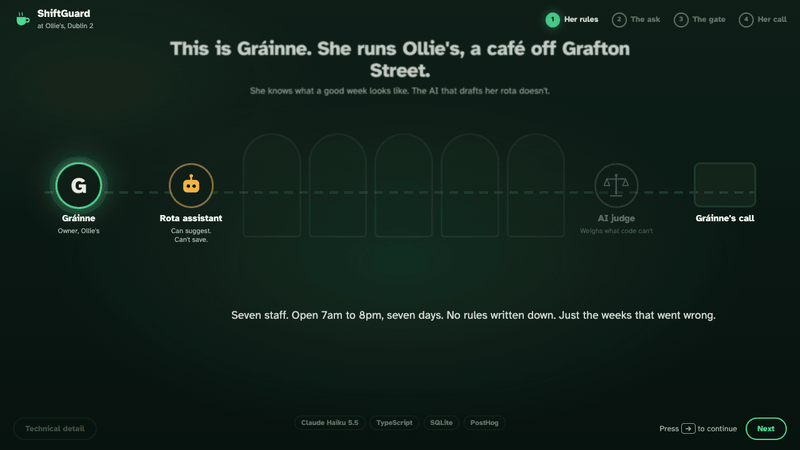
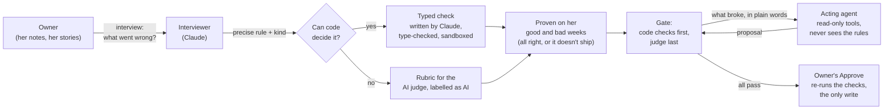
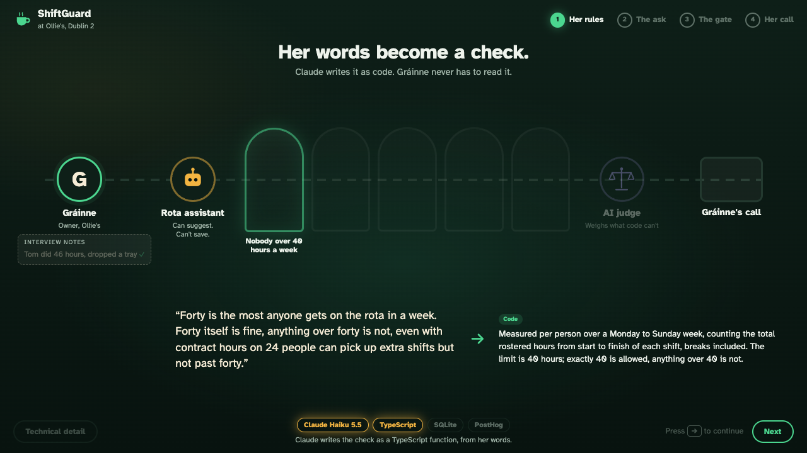
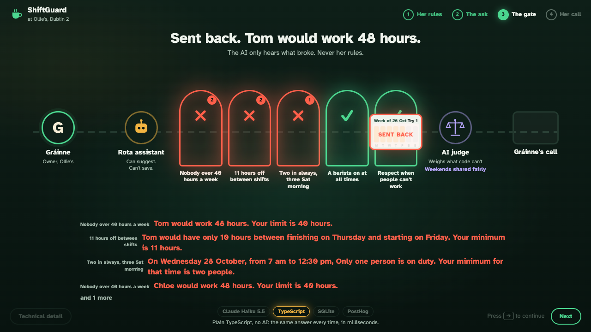
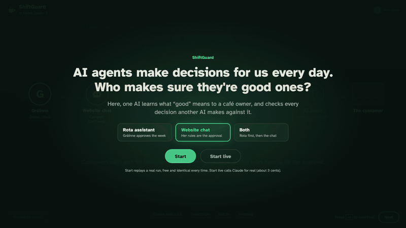

# taste-to-evals

**An agent interviews a business owner, turns her plain-language rules into typed checks (and an AI-judge rubric for the one rule code can't decide), and gates every proposal another agent makes on them before a human approves.**

The demo case is ShiftGuard, running at Ollie's, an invented café in Dublin. Its owner, Gráinne, never wrote her rules down. A rota assistant, which has never seen her rules and can't save anything, has to get every draft past her gate. Only her Approve changes the week.



*Presented at AI Tinkerers Dublin, 28 October 2026. Everything runs locally; every name and number is synthetic.*

## The problem

Agents are starting to act on businesses: drafting rotas, answering customers, booking tables. The people who know what "good" looks like are the owners, and their rules live in their heads, as taste. They aren't written down, they have exceptions, and the agent acting for them (often a vendor's, with a prompt they don't control) doesn't know them.

Evals usually get written by engineers, after the fact. This project tries the other direction: start from the owner's taste and end with tests that run before anything happens.

## How it works



1. **The interview asks about bad weeks, not rules.** "Tell me about a time a rota went wrong on hours." Gráinne: Tom did 46 hours covering for Niamh, and dropped a full tray at the Saturday rush. Out comes *Max 40 hours a week, breaks counted, exactly 40 allowed, no exceptions for sick cover.* (`src/interview.ts`)
2. **Each rule becomes a check, or a rubric.** If code can decide it from the facts, Claude writes a TypeScript `check(rota)` function. If it needs judgement ("weekends shared fairly"), it becomes a rubric for an AI judge that's labelled as AI everywhere it shows up. (`src/generate.ts`, `src/judge.ts`, output in [`checks/`](checks/))
3. **No rule ships without examples.** Every check runs against weeks the owner calls fine and weeks she doesn't, plus edge cases Claude writes. It has to get all of them right before it guards anything. (`src/setup.ts`, `src/examples.ts`)
4. **The acting agent is boxed in.** The rota assistant gets two tools, `read_week` and `read_staff`. It never sees her rules; when a draft breaks one, it hears only what broke ("Tom would work 48 hours. Your limit is 40."). Tests fail if it's ever given a tool that isn't read-only or can reach the store. (`src/agent.ts`, `src/agent.test.ts`)
5. **Code first, judge last.** The gate runs every typed check. The AI judge is asked only when they all pass, so the model never gets a vote on something arithmetic can settle. (`src/gate.ts`)
6. **Only the human writes.** Approve is the single code path that saves a rota, and it re-runs every check instead of trusting the stored result. (`src/store.ts`)
7. **Every run leaves evidence.** A one-page PDF per run: what was asked, every try, what each rule said, the judge's reason, who approved, what it cost. [Sample](docs/evidence-sample.pdf). (`src/evidence.ts`)

The full walk-through, with the data model and the safety boundaries, is in [docs/how-it-works.md](docs/how-it-works.md).

| Her words become a check | The gate sends the draft back |
|---|---|
|  |  |

## Second act: the same gate on a website chatbot

At the demo, people asked whether this only works for rotas. It doesn't: the second act points the same gate at Ollie's website chat, which talks to customers with nobody checking it first.

- Gráinne's chatbot rules come from the same interview: never call anything allergen-safe unless her allergen sheet says so, no discounts ever, bookings up to 8 between 7am and 7pm, and "sound like us" (judged).
- Code can't read free text reliably, so **Claude reads, code decides**: Claude lists only what a draft reply *promises* (a booking for 10 at 7:30pm), and her typed checks decide on those promises.
- Customers can't wait for a human, so here **the gate is the approval**. A passing reply goes out in about a second. A stopped draft goes back to the bot with only what broke. After three stopped drafts the customer gets a holding line and the question waits for Gráinne.



### Where else the gate fits

The pattern needs three things: an agent that **proposes** instead of acting, rules the owner can tell stories about, and a single human or code path that **writes**. Places it maps onto directly:

| Agent | Owner's rules that become checks | Judged |
|---|---|---|
| Refunds and returns | Never above €50 without a person; never on final-sale items | "Was the customer treated fairly?" |
| Purchasing | Only approved suppliers; nothing over budget per category | "Is this a sensible order for the week?" |
| Appointment booking | Never double-book a room; 15 minutes between clients | Tone of the confirmation |
| Outbound email | Never mention pricing that isn't on the rate card; no attachments | "Does this sound like us?" |
| Pricing changes | Never below cost; never more than 10% in a day | "Does it fit the brand?" |

The domain types (`src/domain.ts`, `src/chat/domain.ts`) and the owner's notes (`data/ollies/`) are café-specific; the interview, generate, prove, gate, judge and approve loop is not.

## Use the gate from any agent (MCP)

The gate is also an [MCP](https://modelcontextprotocol.io) server, so Claude Desktop, Claude Code or any other MCP client has to pass the same rules. Every tool is read-only; there's no tool that saves a rota or sends a reply.

| Tool | What it does |
|---|---|
| `read_rules` | Gráinne's rules, in her words, and whether code or the AI judge checks each one |
| `read_week` | This week's rota, every shift with its id |
| `read_staff` | Staff, roles, who's trained on the coffee machine, who can't work when |
| `check_rota_change` | Runs a proposed change (absences, shifts removed, shifts added) through the gate; returns what broke |
| `check_chat_reply` | Reads what a customer reply promises and checks it; returns whether it may be sent |

**Claude Code:**

```bash
claude mcp add shiftguard -- "$(pwd)/node_modules/.bin/tsx" "$(pwd)/src/mcp.ts"
```

**Claude Desktop** (`claude_desktop_config.json`):

```json
{
  "mcpServers": {
    "shiftguard": {
      "command": "/absolute/path/to/taste-to-evals/node_modules/.bin/tsx",
      "args": ["/absolute/path/to/taste-to-evals/src/mcp.ts"]
    }
  }
}
```

The server reads the project's `.env`. Then ask: *"Sarah's off sick all next week. Redo the rota so it passes Gráinne's rules."* Code checks run without a key. The AI judge and `check_chat_reply` call Claude, so they need `ANTHROPIC_API_KEY` in `.env`.

## Quick start

Requires Node.js 22.13 or later (it uses the built-in `node:sqlite`) and pnpm.

```bash
git clone https://github.com/AIwithDiego/taste-to-evals && cd taste-to-evals
pnpm install
pnpm demo        # http://localhost:4321
```

Pick an act on the title card and press **Start**. It replays a recorded run from [`replay/`](replay/): no API key, no internet. Press → or Space to move on; Approve is a real click. **Technical detail** (bottom left) shows the check code, the judge's reasoning, and every Claude call with its cost.

To run it live, copy `.env.example` to `.env`, add your `ANTHROPIC_API_KEY` and press **Start live**. Live runs are saved to `runs/`, and **Start** then replays your latest one.

| Command | What it does |
|---|---|
| `pnpm demo` | The demo screen (replay or live) |
| `pnpm rota-setup [rule\|all]` | Interview, write the check, prove it, in the terminal. Rules: `hours`, `rest`, `staffing`, `barista`, `availability`, `fair` |
| `pnpm propose "request"` | One rota request through the assistant and the gate |
| `pnpm approve <id>` | Approve a passing proposal (re-checks first) |
| `pnpm chat-setup [rule\|all]` | Same as rota-setup, for the chatbot rules |
| `pnpm chat ["message" ...]` | A customer conversation, every draft through the gate |
| `pnpm mcp` | The MCP server over stdio |
| `pnpm test` | 31 tests; no key or network needed |

Live setup rewrites the files in `checks/`. Those files are what Claude wrote for the recorded runs, formatted for reading.

## What it cost

Everything runs on Claude Haiku 5.5 (`src/claude.ts`).

| Step | Claude calls | Cost |
|---|---|---|
| Setting up all ten rules (interview, write, prove) | 144 | about $0.10 |
| One rota request, two tries, judged and approved | 5 | about $0.01 |
| A customer conversation, two replies, one stopped draft | 8 | about $0.001 |

## Observability (optional)

Set `SHIFTGUARD_TELEMETRY=on` and a PostHog project key in `.env`, and every live run becomes one trace in PostHog's LLM analytics. Each Claude call is a generation with its tokens and cost, each of the owner's checks is a span in the same trace, and `shiftguard_check` / `shiftguard_gate_run` events give the failure rate by rule, code versus judge. Traces include the full prompts and replies. It's off by default. (`src/telemetry.ts`)

## Safety boundaries, stated plainly

- **The checks Claude writes** are screened (no imports, no `process`, no `eval`, no timers or network names) and run in a `node:vm` context with nothing in it, code generation from strings disabled, and a one-second limit. That's enough for a local demo with synthetic data. `node:vm` is not a security boundary, so in production run generated code in a separate process or an isolate with no file or network access, and review it before it guards anything real.
- **The acting agents** have read-only tools and no access to the store; tests enforce both.
- **Writes** happen in exactly two places, `approve()` for a rota and `deliver()` for a chat reply, and both re-run the code checks before writing.

## What I learned

The longer version, including what didn't work, is in [LEARNINGS.md](LEARNINGS.md). The short version:

1. Owners don't know their rules until something breaks. Ask about the bad week, not the rule.
2. Every rule ships with a passing and a failing example, or it isn't a rule yet.
3. Code checks first. The AI judge goes last, only for what code can't decide, and it's labelled.
4. The agent that acts has no write tool. Only the approve step writes, and only after a passing run.
5. For an agent that talks to customers, the gate is the approval. Whatever can't pass goes to a person.

## Project layout

```
src/            interview, generate, prove, gate, judge, store, evidence, MCP server, demo server
src/chat/       the website chatbot act: bot, claims reader, chat gate, delivery
checks/         the checks and rubrics Claude wrote from the interview (*.ts, *.rubric.json, *.rule.json)
data/ollies/    the owner's notes, staff, menu, allergen sheet, weekend history (all invented)
web/            the demo screen (vanilla TypeScript, bundled with esbuild on request)
replay/         one recorded run of each kind, so the demo works offline
docs/           how it works, decisions, sample evidence page, media
```

## Built with

TypeScript, [Claude](https://www.anthropic.com/claude) (Haiku 5.5) through the Anthropic SDK with structured outputs, the official MCP TypeScript SDK, Node's built-in SQLite, esbuild, and PostHog for traces. No framework on the front end.

## License

MIT. Built by [Diego Bauer](https://www.aiwithdiego.com) in Dublin.
