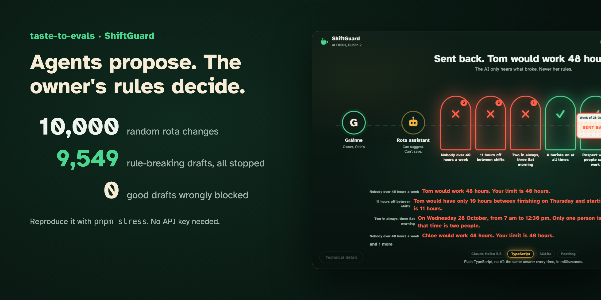
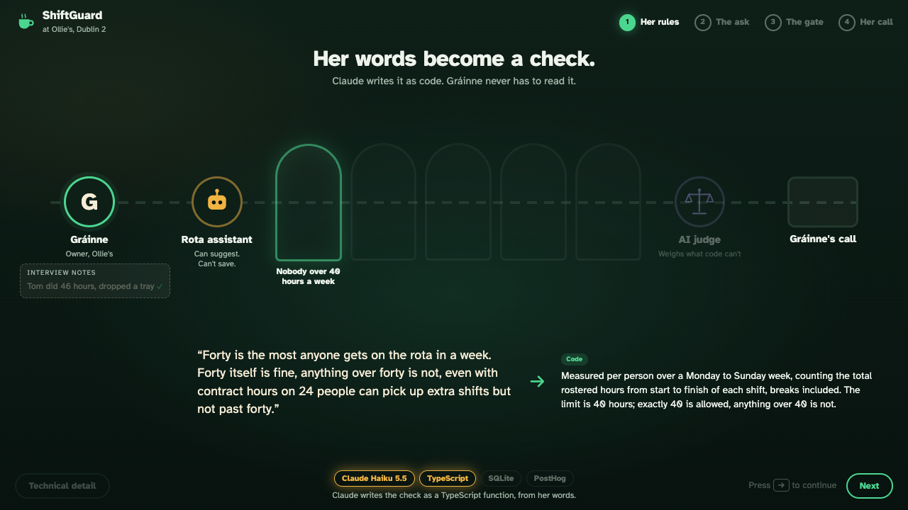
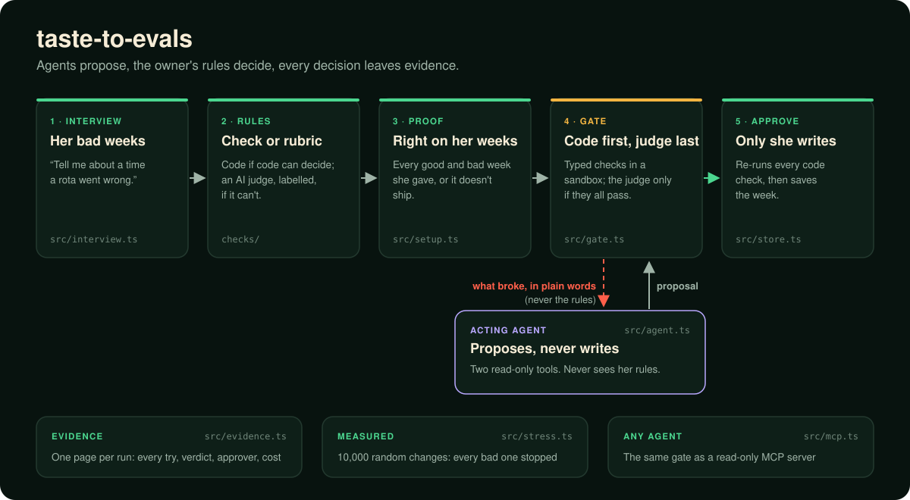

# taste-to-evals

**Agents propose, owners' rules decide, every decision leaves evidence.**

[](https://aiwithdiego.github.io/taste-to-evals/)
[](docs/stress-test.md)
[](https://github.com/AIwithDiego/taste-to-evals/actions/workflows/ci.yml)


[](LICENSE)

[](https://aiwithdiego.github.io/taste-to-evals/)

A case study. Built in about a week with Claude Code for a five-minute slot at AI Tinkerers Dublin, 28 October 2026; governance pass in November. Every name and number in it is synthetic.

**[Open the live demo](https://aiwithdiego.github.io/taste-to-evals/)** (a recorded run, no key needed) · [Sample evidence page](docs/evidence-sample.pdf) · [Run it yourself](#run-it-yourself)

**Contents:** [The problem](#the-problem) · [Research](#research) · [What it does](#what-it-does) · [Results](#results) · [The build](#the-build) · [Design system](#design-system) · [What went wrong](#what-went-wrong) · [What I learned](#what-i-learned) · [EU AI Act and GDPR](#eu-ai-act-and-gdpr) · [Run it yourself](#run-it-yourself)

## The problem

Agents are starting to draft staff rotas, answer customers and book tables for small businesses. Many run with no oversight and leave no record of why they did what they did. The rules they should follow live in the owner's head, and the agent acting for her is often a vendor's, with a prompt she doesn't control.

That carries real risk for the owner:

- **A rota that breaks her own rules:** someone on 48 hours, a morning with nobody trained on the coffee machine, a closing shift followed by an opening one.
- **A chatbot that promises what she wouldn't:** a nut-free claim her allergen sheet doesn't support, a discount, a table for 10 at 7:30pm when the last booking is at 7.
- **No record:** when something goes wrong, nobody can show what the agent was asked, what it tried and who said yes.

> Evals are written by engineers for engineers. Here the owner's stories become the tests, and no agent gets past them without her.

## Research

**What already exists.** Before building, I mapped the field (17 Oct 2026). Eval platforms (Braintrust, Confident AI, PromptLayer, Arize, Langfuse) start at $29 to $250 a month and assume someone who writes code or prompts; the non-engineer is an annotator at best. Humanloop, the one aimed at domain experts, is gone. Guardrail and policy tools (AWS AgentCore Policy, NeMo Guardrails, Guardrails AI, Giskard) serve developers, security and enterprise teams. Rota apps like Deputy and 7shifts already ship typed checks with a confirm tap, but the rules are vendor menus; nobody interviews the owner. The gap: custom agents for small businesses with no platform underneath (WhatsApp bots, n8n flows, bespoke Claude agents).

**Who it's for.** Builders who ship agents into small businesses, starting with us: this is the gate AIwithDiego puts on the agents it builds for clients. The owner is the person the interview talks to, so every screen speaks her language; the builder gets the checks, the trace and the evidence page.

**The limits we chose.** Code decides every rule it can, and the AI judge only advises on what's left: the literature is split on judges ([over 80% agreement with people](https://arxiv.org/abs/2306.05685), but [lenient](https://arxiv.org/abs/2406.12624) and [sensitive to order](https://arxiv.org/abs/2305.17926)), so a judge never passes a draft alone. The acting agent never writes. No rule ships without examples. Nothing ranks staff by who is "reliable": that kind of profiling is what would make a rota tool high-risk under the AI Act.

**What I didn't build.**

| Choice | Why | Trade-off |
|---|---|---|
| Not a SaaS for café owners | Rota apps already bundle a gate, and AWS gives developers plain-language policy | The café is a demo case, not a market |
| Not another eval platform | That market has consolidated around tools for engineers | No dashboards; the output is checks, traces and evidence |
| The acting agent never sees the rules | The agent acting on your business is often a vendor's | More retries and cost per request |
| For the chat, the gate is the approval | Customers can't wait for a person | No one reviews each reply; three stopped drafts go to the owner |
| Traces carry structure only by default | Staff names and sick days are personal and health data | Debugging a prompt means turning content on for that run |

Longer write-ups in [`docs/decisions/`](docs/decisions/).

## What it does

The case: Gráinne runs Ollie's, an invented café in Dublin. She never wrote her rules down. An interview turns her stories into checks; a rota assistant that has never seen her rules and can't save anything has to get every draft past them; only her Approve changes the week. The same gate then guards her website chat.

| Control | What it does | Where |
|---|---|---|
| **Least privilege** | The acting agent has two read-only tools, never sees the rules, and only hears what broke. A test fails if it's ever given a write path. | `src/agent.ts`, `src/agent.test.ts` |
| **Human oversight** | Approve is the only code that saves a rota, and it re-runs every code check instead of trusting the stored result. | `src/store.ts` |
| **Isolated generated code** | The checks Claude writes are screened (no imports, `eval`, timers or network names) and run in an empty `node:vm` context with a one-second limit. | `src/sandbox.ts` |
| **Code first, AI judge last** | Code decides every rule it can. The AI judge weighs only what's left, runs only after code passes, and is labelled "AI" everywhere. | `src/gate.ts`, `src/judge.ts` |
| **Evidence per decision** | A one-page PDF per run: what was asked, every try, each rule's verdict, the judge's reason, who approved, what it cost. [Sample](docs/evidence-sample.pdf). | `src/evidence.ts` |
| **Observability, private by default** | Every live run can be one PostHog trace. Only structure goes to analytics; prompts, replies and names stay out unless you turn them on. | `src/telemetry.ts`, `src/telemetry.test.ts` |
| **Measured, in CI** | 10,000 random rota changes through the checks Claude wrote and a hand-written version of the same rules. CI fails on any disagreement. | `src/stress.ts`, `src/reference.ts` |

<table>
<tr>
<td width="50%"></td>
<td width="50%"></td>
</tr>
<tr>
<td>Her story becomes a precise rule, then a check.</td>
<td>The gate sends the draft back with only what broke.</td>
</tr>
</table>



1. **Interview** (`src/interview.ts`): asks about bad weeks, not rules. Tom did 46 hours covering for Niamh and dropped a tray, so the rule is *max 40 hours a week, breaks counted, exactly 40 allowed, no exceptions for sick cover.*
2. **Check or rubric** (`src/generate.ts`, `src/judge.ts`, output in [`checks/`](checks/)): if code can decide it, Claude writes a TypeScript `check(rota)`; if it needs judgement ("weekends shared fairly"), it becomes a rubric for an AI judge, labelled as AI.
3. **Proof** (`src/setup.ts`, `src/examples.ts`): every check must get all of her good and bad weeks right, plus edge cases Claude writes, before it guards anything.
4. **Gate** (`src/gate.ts`): typed checks first; the judge only if they all pass. The agent hears "Tom would work 48 hours. Your limit is 40.", never the rule.
5. **Approve** (`src/store.ts`): the single write path, which re-runs every code check. Then the evidence page (`src/evidence.ts`).

**Second act, the website chat.** At the demo, people asked whether this only works for rotas. The same gate guards Ollie's website chat. Code can't read free text reliably, so **Claude reads, code decides**: Claude lists only what a draft reply promises (a booking for 10 at 7:30pm) and her typed checks rule on those promises. The chat tells customers they're talking to an AI. Customers can't wait for a person, so here the gate is the approval: a passing reply goes out in about a second; after three stopped drafts the customer gets a holding line and the question waits for Gráinne.


**Any agent, through MCP.** The gate is also an [MCP](https://modelcontextprotocol.io) server with five read-only tools (`read_rules`, `read_week`, `read_staff`, `check_rota_change`, `check_chat_reply`), so Claude Desktop, Claude Code or any MCP client has to pass the same rules. Setup in [Run it yourself](#run-it-yourself).

**Where else the gate fits.** It needs an agent that **proposes** instead of acting, rules the owner can tell stories about, and one path that **writes**:

| Agent | Owner's rules that become checks | Judged |
|---|---|---|
| Refunds and returns | Never above €50 without a person; never on final-sale items | "Was the customer treated fairly?" |
| Purchasing | Only approved suppliers; nothing over budget per category | "Is this a sensible order for the week?" |
| Appointment booking | Never double-book a room; 15 minutes between clients | Tone of the confirmation |
| Outbound email | Never mention pricing that isn't on the rate card; no attachments | "Does this sound like us?" |
| Pricing changes | Never below cost; never more than 10% in a day | "Does it fit the brand?" |

## Results

| | Weeks | Gate result |
|---|---|---|
| Break at least one rule | 9,549 | 9,549 stopped (100%) |
| Break no rule | 451 | 0 wrongly stopped |

10,000 random changes (one to three edits each) to Ollie's normal week, none of them one of the weeks the checks were proven on. Each goes through the checks Claude wrote and through a hand-written answer key of the same five code rules (`src/reference.ts`). They agree on every week; per-rule numbers in [`docs/stress-test.md`](docs/stress-test.md). Reproduce it with `pnpm stress`, no API key needed. The AI-judged rule (weekend fairness) is not in this test: it needs an API key and its verdicts aren't deterministic.

What it cost, all on Claude Haiku 5.5:

| Step | Claude calls | Cost |
|---|---|---|
| Setting up all ten rules (interview, write, prove) | 144 | about $0.10 |
| One rota request, two tries, judged and approved | 5 | about $0.01 |
| A customer conversation, two replies, one stopped draft | 8 | about $0.001 |

## The build

Built by Diego Bauer with Claude Code. I designed the flow and the demo, made the product, architecture and security calls, and presented it. Claude wrote most of the code under my direction, with tests at every step. The work happened in a private lab repo; this public copy started on 29 October, so its history is short. The milestones:

| When | What landed |
|---|---|
| 20 Oct | Needs list agreed; a one-rule spike: Claude interviews a role-played Gráinne, writes the 40-hour check, and gets all 8 weeks right, about $0.14 a run |
| 20 Oct | The gate and a proposal-only assistant: her five code checks stop the flu-week cover until round 3 passes; only Approve writes |
| 20 Oct | "Weekends shared fairly" as a labelled AI-judge rule, agreeing with Gráinne on 6 of 6 weeks |
| 21 Oct | The demo screen, presenter-paced, live or replayed; the evidence page; the gate as an MCP server; PostHog traces |
| 21 Oct | The website chat, gated by the same owner: four rules, each right on all her replies |
| 28 Oct | Presented at AI Tinkerers Dublin |
| 29 Oct | Public repo, [`bed9243`](https://github.com/AIwithDiego/taste-to-evals/commit/bed9243) |
| 5 Nov | Governance pass: private-by-default traces, the 10,000-change stress test in CI, AI disclosure in the chat, EU AI Act and GDPR mapping checked by [Hank](https://github.com/AIwithDiego/hank), my security and compliance agent ([`caed783`](https://github.com/AIwithDiego/taste-to-evals/commit/caed783)) |
| 9 Nov | Live demo on GitHub Pages: the demo screen replaying the recorded runs as static files (`scripts/build-pages.ts`) |

## Design system

Short version: it's a one-screen demo, built to be read from the back of a room.

### How it got there

The first screen was three plain columns with the right content and no pull. Diego's note on 20 Oct: "it has to make them feel something." The redesign kept the content and changed the shape. The rota became a card that travels one track across the screen: Gráinne, the assistant, five rule gates, the AI judge, her Approve. Gates scan it and glow green or red; red sends it back on a return arc. Her handwritten rules fly out of her notebook and become the gates. One caption per moment, in plain words; the check code, judge reasoning and cost sit behind **Technical detail**.

### Principles

| | |
|---|---|
| **Plain words on the surface** | Names, hours, days, one sentence per broken rule. A mixed audience follows it; engineers open Technical detail. |
| **It's real, never a mock-up** | The screen plays back what the engine did. The replay is the default so venue wifi can't break it. |
| **Presenter-paced** | Each moment holds until → or Space. Approve is a real click. |
| **Code and AI look different** | Every rule is tagged Code or AI judge, everywhere it shows up. |
| **Big type** | The organisers asked for it; the base size scales with the screen (13 to 22px). |

### Tokens

| Token | Value | Used for |
|---|---|---|
| `--night` | `#08130f` | Background, a bottle-green dark |
| `--milk` / `--milk-soft` | `#eef3ec` / `#9fb3a7` | Text / secondary text |
| `--chalk` | `#f6ecd6` | Gráinne's handwriting, headlines |
| `--green` | `#4bd68f` | A rule kept, the main action |
| `--crema` | `#f2b441` | Working, focus ring |
| `--tomato` | `#ff5f4a` | A rule broken |
| `--violet` | `#b9a8ff` | The AI judge |

Type: [Atkinson Hyperlegible](https://www.brailleinstitute.org/freefont/), made for readers with low vision, served locally. Source: [`web/styles.css`](web/styles.css).

### Accessibility, measured

- **Contrast on `--night`:** text 16.8:1, secondary text 8.5:1, green 10.2:1, crema 10.2:1, violet 9.1:1, tomato 6.3:1. Dark text on the green button 10.2:1.
- **One weak spot:** chapter labels you haven't reached yet sit at 55% opacity, about 3.4:1. Fine for large bold text, short of 4.5:1 for small text.
- **Focus:** a 3px crema ring on every button and the request box.
- **Motion:** `prefers-reduced-motion` turns off the travelling and the notebook animation.
- **Not done:** forced-colours mode and small screens. It's a projector demo; on a phone it's cramped.

## What went wrong

Each of these was caught and fixed during the build; the test or file that now guards it is on the right.

| | |
|---|---|
| **Owners don't think in rules.** The first interview asked Gráinne for her rules and got vague answers. Asking "tell me about a time a rota went wrong" brought every rule back with a number, a boundary and an exception. | [`src/interview.ts`](src/interview.ts) |
| **The rules in the prompt hid the point.** With her rules in its prompt, the assistant never broke one (4 of 4 runs), so the gate never caught anything. The agent acting on your business is often a vendor's; now it only hears what broke. | [`src/agent.test.ts`](src/agent.test.ts) |
| **A sick day was only a sentence.** "Sarah's out all week with the flu" lived only in the request, so a draft that left Sarah on the rota passed every check. Now the request is read first and her absence is written onto the week. | [`src/request.ts`](src/request.ts) |
| **The judge was blind to history.** The weekend history for the example weeks never reached the AI judge. The examples caught it before the rule shipped. | [`src/examples.ts`](src/examples.ts) |
| **My answer key was wrong, not Claude.** The stress test's first run disagreed on three weeks. My hand-written reference counted one person on two overlapping shifts as two people; Claude's check counted people. | [`src/reference.ts`](src/reference.ts) |
| **Traces leaked staff health data.** The first version sent full prompts to PostHog, staff names and "off sick" included. Now an allow-list sends structure only, and a test fails if a name or prompt leaves the machine. | [`src/telemetry.test.ts`](src/telemetry.test.ts) |

## What I learned

The longer version is in [LEARNINGS.md](LEARNINGS.md).

- **Ask about the bad week, not the rule.** Stories carry the edge cases that rule statements leave out.
- **A rule isn't a rule until it has examples.** A passing and a failing week, or it doesn't ship.
- **Code first, the judge last, and labelled.** The model never gets a vote on something arithmetic can settle.
- **One write path, and it trusts nothing.** That makes the safety story one sentence long, and a test enforces it.
- **An answer key is code too.** It needs its own second opinion.
- **Privacy by default has to be tested,** or it's a promise.

**What's next:** a pluggable domain (owner notes, types and a gate adapter per business), generated checks in a real isolate with an owner review step, and letting the owner disagree with a verdict so every disagreement becomes a new example week.

## EU AI Act and GDPR

ShiftGuard is a local demo on synthetic data. It is not a product and makes no compliance claim. It was designed with the EU AI Act and GDPR in mind. A rota assistant could be a high-risk system under AI Act Annex III point 4(b) (task allocation at work), depending on what it bases decisions on. If so, those duties apply from 2 December 2027 under the 2026 AI Omnibus.

| Requirement | What it asks | Where this repo does it |
|---|---|---|
| AI Act Art. 12 | Automatic logs of what the system did | Run record per proposal (`src/propose.ts`) and evidence PDF (`src/evidence.ts`) |
| AI Act Art. 14 | A person can oversee, override and decide | Only the owner's Approve writes a rota, and it re-runs the code checks first (`src/store.ts`) |
| AI Act Art. 15 | Accuracy, robustness, cybersecurity | The stress test above (`src/stress.ts`); generated checks in `node:vm` with no imports, eval or network and a one-second limit (`src/sandbox.ts`) |
| AI Act Art. 50 | People know when AI is involved | The website chat says it's an AI assistant (`web/main.ts`); AI judge verdicts labelled "AI" (`src/gate.ts`, `src/evidence.ts`) |
| Least privilege | The agent can't act beyond its job | Only `read_week` and `read_staff`; a test fails if a write path appears (`src/agent.ts`, `src/agent.test.ts`) |
| GDPR Art. 5(1)(c), Art. 25 | Data minimisation, privacy by default | Telemetry off by default; when on, an allow-list of fields to PostHog's EU host; content only with `SHIFTGUARD_TELEMETRY_CONTENT=on` (`src/telemetry.ts`) |
| GDPR Art. 22 | No solely automated decision with significant effect | No rota takes effect without a named person's approval (`src/store.ts`) |

**What a real deployment would still need:** a documented AI Act classification (including whether the Art. 6(3) exemption applies); a DPIA (GDPR Art. 35) and a lawful basis for staff data; telling workers before use (AI Act Art. 26(7), GDPR Art. 13); treating absence reasons such as "off sick" as health data (GDPR Art. 9), which the demo stores as free text; retention and deletion rules; a processing agreement and transfer basis for the model provider; a production-grade sandbox (`node:vm` is not a security boundary); the AI judge rule in the stress test and re-asked at approval; a person approving chat replies, or a case for why the gate is enough; and proof that approvals are meaningful, not rubber stamps.

## Ground rules

- **The acting agent never writes.** Two read-only tools; only the owner's Approve saves.
- **Synthetic data only.** Ollie's, Gráinne and her staff are invented. Never a client's data.
- **Private by default.** Nothing leaves the machine unless you turn telemetry on, and then only structure.
- **Not a product or a compliance tool.** It shows the controls; a real deployment needs the list above.
- **Café-specific types.** `src/domain.ts` and `src/chat/domain.ts` are a café's; the interview, prove, gate and approve loop is not.

## Run it yourself

Requires Node.js 22.13 or later (it uses the built-in `node:sqlite`) and pnpm.

1. `git clone https://github.com/AIwithDiego/taste-to-evals && cd taste-to-evals && pnpm install`
2. `pnpm demo`, open http://localhost:4321, pick an act and press **Start**. It replays a recorded run from [`replay/`](replay/): no key, no internet. → or Space moves on; Approve is a real click.
3. To run it live: copy `.env.example` to `.env`, add `ANTHROPIC_API_KEY`, press **Start live**. Live runs go to `runs/`.
4. `pnpm test` (33 tests) and `pnpm stress` (the number at the top), no key or network needed.
5. Use the gate from Claude Code: `claude mcp add shiftguard -- "$(pwd)/node_modules/.bin/tsx" "$(pwd)/src/mcp.ts"`, then ask *"Sarah's off sick all next week. Redo the rota so it passes Gráinne's rules."*

<details>
<summary>All commands, Claude Desktop setup, observability</summary>

| Command | What it does |
|---|---|
| `pnpm demo` | The demo screen (replay or live) |
| `pnpm rota-setup [rule\|all]` | Interview, write the check, prove it, in the terminal. Rules: `hours`, `rest`, `staffing`, `barista`, `availability`, `fair` |
| `pnpm propose "request"` | One rota request through the assistant and the gate |
| `pnpm approve <id>` | Approve a passing proposal (re-checks first) |
| `pnpm chat-setup [rule\|all]` | Same as rota-setup, for the chatbot rules |
| `pnpm chat ["message" ...]` | A customer conversation, every draft through the gate |
| `pnpm mcp` | The MCP server over stdio |
| `pnpm test` | 33 tests; no key or network needed |
| `pnpm stress [count] [seed]` | The stress test; no key or network needed |
| `pnpm pages` | Builds the static live demo into `dist/pages/` |

Live setup rewrites the files in `checks/`. Those files are what Claude wrote for the recorded runs, formatted for reading.

**Claude Desktop** (`claude_desktop_config.json`):

```json
{
  "mcpServers": {
    "shiftguard": {
      "command": "/absolute/path/to/taste-to-evals/node_modules/.bin/tsx",
      "args": ["/absolute/path/to/taste-to-evals/src/mcp.ts"]
    }
  }
}
```

The server reads the project's `.env`. Code checks run without a key; the AI judge and `check_chat_reply` call Claude, so they need `ANTHROPIC_API_KEY`.

**Observability.** Set `SHIFTGUARD_TELEMETRY=on` and a PostHog project key in `.env`, and every live run becomes one trace in PostHog's LLM analytics (EU host): each Claude call as a generation with tokens, cost and latency, each of the owner's checks as a span. By default the trace carries structure only (rule ids, verdicts, counts, tokens, cost, latency); `SHIFTGUARD_TELEMETRY_CONTENT=on` adds prompts, replies and names while debugging. `src/telemetry.test.ts` fails if any of them leaks.

</details>

## Repo map

```
src/              interview, generate, prove, gate, judge, store, evidence, MCP server, demo server
src/chat/         the website chat act: bot, claims reader, chat gate, delivery
checks/           the checks and rubrics Claude wrote from the interview
data/ollies/      the owner's notes, staff, menu, allergen sheet, weekend history (all invented)
web/              the demo screen (vanilla TypeScript, bundled with esbuild on request)
replay/           one recorded run of each kind, so the demo works offline
scripts/          build-pages.ts: the static live demo
docs/             how it works, decisions, stress test results, sample evidence page, images
```

## Credits

TypeScript, [Claude](https://www.anthropic.com/claude) (Haiku 5.5) through the Anthropic SDK with structured outputs, the official MCP TypeScript SDK, Node's built-in SQLite, esbuild, PostHog for traces, and Atkinson Hyperlegible by the Braille Institute. Thanks to AI Tinkerers Dublin for the slot and the questions that became the second act. Issues and pull requests welcome: [CONTRIBUTING.md](CONTRIBUTING.md). Security issues: [SECURITY.md](SECURITY.md).

## Licence

MIT · Made in Dublin by [Diego Bauer](https://www.aiwithdiego.com) · [LinkedIn](https://www.linkedin.com/in/diego-bauer-domeyko/)

Built by [AIwithDiego](https://www.aiwithdiego.com). Need something like this for your team? [Talk to me](https://www.aiwithdiego.com).
