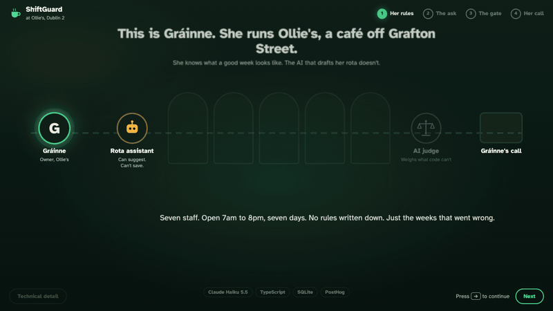
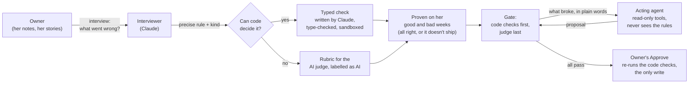
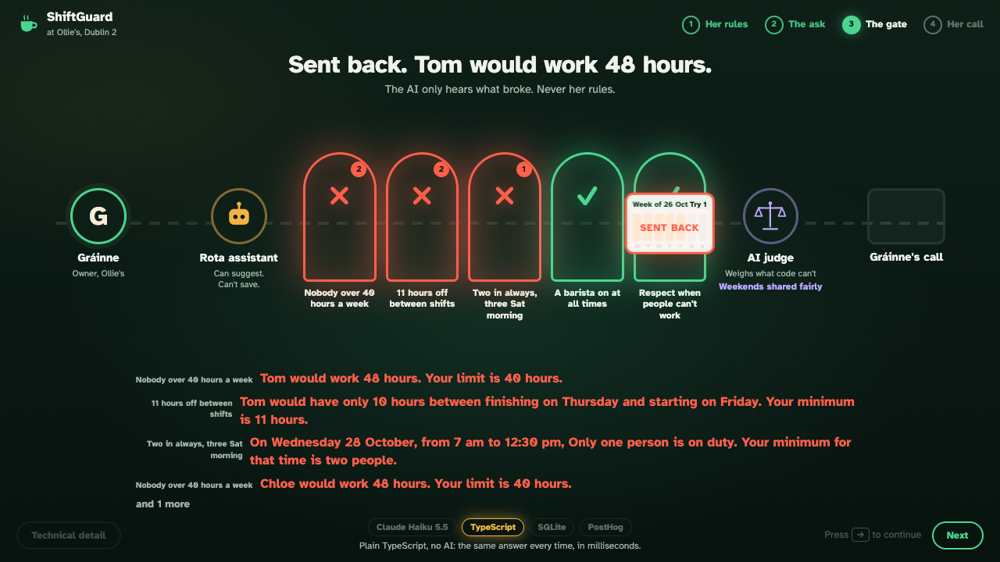
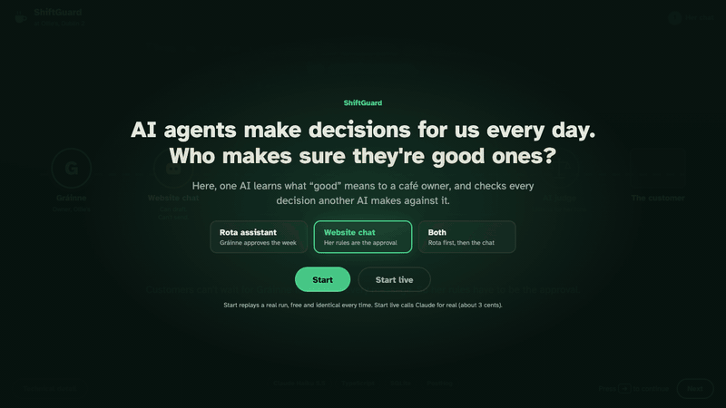

# taste-to-evals

[Español](README.es.md)

[](https://github.com/AIwithDiego/taste-to-evals/actions/workflows/ci.yml)   

**Agents propose, owners' rules decide, every decision leaves evidence.**

10,000 random rota changes: every rule-breaking draft stopped, no good one blocked. Reproduce the test with `pnpm stress`; no API key is needed.

<sub>Built by [AIwithDiego](https://www.aiwithdiego.com). Need this for your team? [Talk to me](https://www.aiwithdiego.com).</sub>



*Presented at AI Tinkerers Dublin, 28 October 2026. Runs locally; every name and number is synthetic.*

```bash
git clone https://github.com/AIwithDiego/taste-to-evals && cd taste-to-evals && pnpm install && pnpm demo
```

## Why this exists

Agents are starting to draft staff rotas, answer customers and book tables for businesses. Many run with no oversight and leave no record of why they did what they did. The rules they should follow live in the owner's head, and the agent acting for her is often a vendor's, with a prompt she doesn't control.

This project puts a gate between the agent and the business. An interview turns the owner's rules into tests. The agent can only propose. Every proposal must pass the tests before a person approves it, and each decision has a trace and an evidence page for later auditing.

## The controls

| Control | What it does | Where |
|---|---|---|
| **Least privilege** | The acting agent has two read-only tools, never sees the rules, and only hears what broke. A test fails if it's ever given a write path. | `src/agent.ts`, `src/agent.test.ts` |
| **Human oversight** | Approve is the only code that saves a rota, and it re-runs every code check instead of trusting the stored result. | `src/store.ts` |
| **Isolated generated code** | The checks Claude writes are screened (no imports, `eval`, timers or network names) and run in an empty `node:vm` context with a one-second limit. | `src/sandbox.ts` |
| **Code first, AI judge last** | Code decides every rule it can. The AI judge weighs only what's left, runs only after code passes, and is labelled "AI" everywhere. | `src/gate.ts`, `src/judge.ts` |
| **Evidence per decision** | A one-page PDF per run: what was asked, every try, each rule's verdict, the judge's reason, who approved, what it cost. [Sample](docs/evidence-sample.pdf). | `src/evidence.ts` |
| **Observability, private by default** | Every live run can be one PostHog trace: each Claude call with tokens, cost and latency, each check as a span. Only structure goes to analytics; prompts, replies and names stay out of it unless you turn them on. | `src/telemetry.ts`, `src/telemetry.test.ts` |
| **Measured, in CI** | 10,000 random rota changes run through the checks Claude wrote and through a hand-written version of the same rules. CI fails on any disagreement. [Results](docs/stress-test.md). | `src/stress.ts`, `src/reference.ts` |

## EU AI Act and GDPR

ShiftGuard is a local demo on synthetic data (Ollie's and its staff are invented). It is not a product and makes no compliance claim. It was designed with the EU AI Act and GDPR in mind. A rota assistant could be a high-risk system under AI Act Annex III point 4(b) (task allocation at work), depending on what it bases decisions on. If so, those duties apply from 2 December 2027 under the 2026 AI Omnibus. The table maps each control to the article it was built against.

| Requirement | What it asks | Where this repo does it |
|---|---|---|
| AI Act Art. 12 | Automatic logs of what the system did | Run record per proposal (`src/propose.ts`) and evidence PDF with every try, verdict, judge reason, approver and cost (`src/evidence.ts`) |
| AI Act Art. 14 | A person can oversee, override and decide | Only the owner's Approve writes a rota, and it re-runs the code checks first (`src/store.ts`) |
| AI Act Art. 15 | Accuracy, robustness, cybersecurity | 10,000 random rota changes against hand-written reference rules: 9,549 of 9,549 bad weeks stopped, 0 of 451 good weeks blocked (`src/stress.ts`, `docs/stress-test.md`). Generated checks run in `node:vm` with no imports, eval or network, and a one-second limit (`src/sandbox.ts`) |
| AI Act Art. 50 | People know when AI is involved | The website chat tells customers they're talking to an AI assistant (`web/main.ts`). AI judge verdicts are labelled "AI" in the gate and the PDF (`src/gate.ts`, `src/evidence.ts`) |
| Least privilege | The agent can't act beyond its job | Rota assistant has only `read_week` and `read_staff`. A test fails if a write path appears (`src/agent.ts`, `src/agent.test.ts`) |
| GDPR Art. 5(1)(c), Art. 25 | Data minimisation, privacy by default | Telemetry off by default. When on, it sends steps, verdicts, tokens and cost to PostHog's EU host through an allow-list of fields. Prompts, replies, rule text and the approver's name only with `SHIFTGUARD_TELEMETRY_CONTENT=on` (`src/telemetry.ts`, `src/telemetry.test.ts`) |
| GDPR Art. 22 | No solely automated decision with significant effect | No rota takes effect without a named person's approval (`src/store.ts`) |

### What a real deployment would still need

- A documented AI Act classification, including whether the Art. 6(3) exemption applies.
- A DPIA (GDPR Art. 35) and a lawful basis for staff data.
- Telling workers before use (AI Act Art. 26(7) for an employer deployer; GDPR Art. 13 notice).
- Staff absence reasons such as "off sick" are health data (GDPR Art. 9). The demo stores them as free text.
- Retention and deletion rules for run records and evidence PDFs.
- A data processing agreement and transfer basis for the model provider: prompts, including staff data, go to Anthropic's API.
- A production-grade sandbox. `node:vm` is not a security boundary.
- The AI judge rule is not in the stress test, and Approve reuses its verdict rather than re-asking.
- The website chatbot sends replies without a person approving each one (the gate is the approval).
- Proof that approvals are meaningful, not rubber stamps.

## How it works

The case: Gráinne runs Ollie's, an invented café in Dublin. She never wrote her rules down. A rota assistant, which has never seen her rules and can't save anything, has to get every draft past her gate. Only her Approve changes the week.



1. **The interview asks about bad weeks, not rules.** "Tell me about a time a rota went wrong on hours." Gráinne: Tom did 46 hours covering for Niamh, and dropped a full tray at the Saturday rush. Out comes *Max 40 hours a week, breaks counted, exactly 40 allowed, no exceptions for sick cover.* (`src/interview.ts`)
2. **Each rule becomes a check, or a rubric.** If code can decide it from the facts, Claude writes a TypeScript `check(rota)` function. If it needs judgement ("weekends shared fairly"), it becomes a rubric for an AI judge that's labelled as AI everywhere it shows up. (`src/generate.ts`, `src/judge.ts`, output in [`checks/`](checks/))
3. **No rule ships without examples.** Every check runs against weeks the owner calls fine and weeks she doesn't, plus edge cases Claude writes. It has to get all of them right before it guards anything. (`src/setup.ts`, `src/examples.ts`)
4. **The acting agent is boxed in.** The rota assistant gets two tools, `read_week` and `read_staff`. It never sees her rules; when a draft breaks one, it hears only what broke ("Tom would work 48 hours. Your limit is 40."). Tests fail if it's ever given a tool that isn't read-only or can reach the store. (`src/agent.ts`, `src/agent.test.ts`)
5. **Code first, judge last.** The gate runs every typed check. The AI judge is asked only when they all pass, so the model never gets a vote on something arithmetic can settle. (`src/gate.ts`)
6. **Only the human writes.** Approve is the single code path that saves a rota, and it re-runs every code check instead of trusting the stored result (the AI judge's verdict is taken from the run). (`src/store.ts`)
7. **Every run leaves evidence.** A one-page PDF per run: what was asked, every try, what each rule said, the judge's reason, who approved, what it cost. [Sample](docs/evidence-sample.pdf). (`src/evidence.ts`)

The full walk-through, with the data model and the safety boundaries, is in [docs/how-it-works.md](docs/how-it-works.md).

| Her words become a check | The gate sends the draft back |
|---|---|
|  |  |

## Second act: the same gate on a website chatbot

At the demo, people asked whether this only works for rotas. It doesn't: the second act points the same gate at Ollie's website chat, which talks to customers with nobody checking it first.

- Gráinne's chatbot rules come from the same interview: never call anything allergen-safe unless her allergen sheet says so, no discounts ever, bookings up to 8 between 7am and 7pm, and "sound like us" (judged).
- Code can't read free text reliably, so **Claude reads, code decides**: Claude lists only what a draft reply *promises* (a booking for 10 at 7:30pm), and her typed checks decide on those promises.
- The chat tells customers up front that they're talking to an AI assistant (EU AI Act Art. 50(1)).
- Customers can't wait for a human, so here **the gate is the approval**. A passing reply goes out in about a second. A stopped draft goes back to the bot with only what broke. After three stopped drafts the customer gets a holding line and the question waits for Gráinne.



### Where else the gate fits

The pattern needs three things: an agent that **proposes** instead of acting, rules the owner can tell stories about, and a single human or code path that **writes**. Places it maps onto directly:

| Agent | Owner's rules that become checks | Judged |
|---|---|---|
| Refunds and returns | Never above €50 without a person; never on final-sale items | "Was the customer treated fairly?" |
| Purchasing | Only approved suppliers; nothing over budget per category | "Is this a sensible order for the week?" |
| Appointment booking | Never double-book a room; 15 minutes between clients | Tone of the confirmation |
| Outbound email | Never mention pricing that isn't on the rate card; no attachments | "Does this sound like us?" |
| Pricing changes | Never below cost; never more than 10% in a day | "Does it fit the brand?" |

The domain types (`src/domain.ts`, `src/chat/domain.ts`) and the owner's notes (`data/ollies/`) are café-specific; the interview, generate, prove, gate, judge and approve loop is not.

## Use the gate from any agent (MCP)

The gate is also an [MCP](https://modelcontextprotocol.io) server, so Claude Desktop, Claude Code or any other MCP client has to pass the same rules. Every tool is read-only; there's no tool that saves a rota or sends a reply.

| Tool | What it does |
|---|---|
| `read_rules` | Gráinne's rules, in her words, and whether code or the AI judge checks each one |
| `read_week` | This week's rota, every shift with its id |
| `read_staff` | Staff, roles, who's trained on the coffee machine, who can't work when |
| `check_rota_change` | Runs a proposed change (absences, shifts removed, shifts added) through the gate; returns what broke |
| `check_chat_reply` | Reads what a customer reply promises and checks it; returns whether it may be sent |

**Claude Code:**

```bash
claude mcp add shiftguard -- "$(pwd)/node_modules/.bin/tsx" "$(pwd)/src/mcp.ts"
```

**Claude Desktop** (`claude_desktop_config.json`):

```json
{
  "mcpServers": {
    "shiftguard": {
      "command": "/absolute/path/to/taste-to-evals/node_modules/.bin/tsx",
      "args": ["/absolute/path/to/taste-to-evals/src/mcp.ts"]
    }
  }
}
```

The server reads the project's `.env`. Then ask: *"Sarah's off sick all next week. Redo the rota so it passes Gráinne's rules."* Code checks run without a key. The AI judge and `check_chat_reply` call Claude, so they need `ANTHROPIC_API_KEY` in `.env`.

## Quick start

Requires Node.js 22.13 or later (it uses the built-in `node:sqlite`) and pnpm.

```bash
git clone https://github.com/AIwithDiego/taste-to-evals && cd taste-to-evals
pnpm install
pnpm demo        # http://localhost:4321
```

Pick an act on the title card and press **Start**. It replays a recorded run from [`replay/`](replay/): no API key, no internet. Press → or Space to move on; Approve is a real click. **Technical detail** (bottom left) shows the check code, the judge's reasoning, and every Claude call with its cost.

To run it live, copy `.env.example` to `.env`, add your `ANTHROPIC_API_KEY` and press **Start live**. Live runs are saved to `runs/`, and **Start** then replays your latest one.

| Command | What it does |
|---|---|
| `pnpm demo` | The demo screen (replay or live) |
| `pnpm rota-setup [rule\|all]` | Interview, write the check, prove it, in the terminal. Rules: `hours`, `rest`, `staffing`, `barista`, `availability`, `fair` |
| `pnpm propose "request"` | One rota request through the assistant and the gate |
| `pnpm approve <id>` | Approve a passing proposal (re-checks first) |
| `pnpm chat-setup [rule\|all]` | Same as rota-setup, for the chatbot rules |
| `pnpm chat ["message" ...]` | A customer conversation, every draft through the gate |
| `pnpm mcp` | The MCP server over stdio |
| `pnpm test` | 33 tests; no key or network needed |
| `pnpm stress [count] [seed]` | The stress test behind the number at the top; no key or network needed |

Live setup rewrites the files in `checks/`. Those files are what Claude wrote for the recorded runs, formatted for reading.

## What it cost

Everything runs on Claude Haiku 5.5 (`src/claude.ts`).

| Step | Claude calls | Cost |
|---|---|---|
| Setting up all ten rules (interview, write, prove) | 144 | about $0.10 |
| One rota request, two tries, judged and approved | 5 | about $0.01 |
| A customer conversation, two replies, one stopped draft | 8 | about $0.001 |

## Observability (optional)

Set `SHIFTGUARD_TELEMETRY=on` and a PostHog project key in `.env`, and every live run becomes one trace in PostHog's LLM analytics (EU host). Each Claude call is recorded as a generation with its tokens, cost and latency, and each of the owner's checks is a span in the same trace. The `shiftguard_check` / `shiftguard_gate_run` events report failure rates by rule, split between code checks and the judge.

By default the trace carries structure only: rule ids, verdicts, counts, tokens, cost and latency. Prompts, replies, rule messages, rule titles, error text and the approver's name stay out of the trace; add `SHIFTGUARD_TELEMETRY_CONTENT=on` to send them while debugging. `src/telemetry.test.ts` fails if any of them leaks. The full record of each decision lives in the local evidence PDF.

## What it won't do

- It isn't a product or a compliance tool. It shows the controls; a real deployment still needs the list above.
- The domain is a café rota and a café chat. The loop works in other domains, but the types in `src/domain.ts` and `src/chat/domain.ts` are café-specific.
- The AI-judged rule is not in the stress test: it needs an API key and its verdicts aren't deterministic.
- `node:vm` isolation is right for a local demo, not for running generated code in production.

---

## Decisions

| Choice | Why | Trade-off |
|---|---|---|
| Code checks first, AI judge last | Arithmetic shouldn't get a model's vote. Code is instant, repeatable and testable; the judge only sees drafts that already pass. | Rules with no formula ("weekends shared fairly") still depend on a model, and can't be stress-tested the same way. |
| The acting agent never sees the rules | Models the real case: the agent acting on your business is often a vendor's, with a prompt you don't control. | More retries and cost per request. With the rules in its prompt, the agent never broke one, so the demo didn't show the gate catching anything. |
| One write path, and it trusts nothing | Approve is the only code that saves, and it re-runs the code checks. The safety story fits in one sentence and a test enforces it. | The judge's verdict is reused from the run, not asked again at approval. |
| For the chatbot, the gate is the approval | Customers can't wait for a person. Passing replies go out in about a second; three stopped drafts go to the owner with a holding line. | No person reviews each reply, so approval depends entirely on the typed checks. |
| Traces carry structure only by default | Staff names and sick days are personal and health data. The evidence PDF keeps the full record locally; analytics doesn't need it. | Debugging a bad prompt means turning content on for that run. |

Longer write-ups in [`docs/decisions/`](docs/decisions/).

## How this was built

Built by Diego Bauer with Claude Code, in about a week in October 2026, for a five-minute slot at AI Tinkerers Dublin. I designed the flow and the demo, made the product, architecture and security calls, and presented it. Claude wrote most of the code under my direction, with tests at every step. In November I added the stress test and private-by-default traces, and had the EU AI Act and GDPR section checked by [Hank](https://github.com/AIwithDiego/hank), my security and EU compliance agent.

## What I learned

The longer version, including what didn't work, is in [LEARNINGS.md](LEARNINGS.md). The short version:

1. Owners don't know their rules until something breaks. Ask about the bad week, not the rule.
2. Every rule ships with a passing and a failing example, or it isn't a rule yet.
3. Code checks first. The AI judge goes last, only for what code can't decide, and it's labelled.
4. The agent that acts has no write tool. Only the approve step writes, and only after a passing run.
5. An answer key is code too. The stress test's first run found a bug in my hand-written rules; Claude's checks were right.
6. Privacy by default has to be tested. The first traces sent staff names and sick days to analytics.

## Project layout

```
src/            interview, generate, prove, gate, judge, store, evidence, MCP server, demo server
src/chat/       the website chatbot act: bot, claims reader, chat gate, delivery
checks/         the checks and rubrics Claude wrote from the interview (*.ts, *.rubric.json, *.rule.json)
data/ollies/    the owner's notes, staff, menu, allergen sheet, weekend history (all invented)
web/            the demo screen (vanilla TypeScript, bundled with esbuild on request)
replay/         one recorded run of each kind, so the demo works offline
docs/           how it works, decisions, stress test results, sample evidence page, media
```

## Built with

TypeScript, [Claude](https://www.anthropic.com/claude) (Haiku 5.5) through the Anthropic SDK with structured outputs, the official MCP TypeScript SDK, Node's built-in SQLite, esbuild, and PostHog for traces. No framework on the front end.

## Contributing

Issues and pull requests welcome. See [CONTRIBUTING.md](CONTRIBUTING.md). Security issues: [SECURITY.md](SECURITY.md).

## License

MIT. Built by [Diego Bauer](https://www.aiwithdiego.com) in Dublin.
